# Base de données

46 tables MySQL (InnoDB, utf8mb4) — script complet : `backend/database/schema.sql` (idempotent, `npm run db:migrate`).

## Tables

`users`, `roles`, `permissions`, `role_permissions`, `user_roles`, `password_resets`, `email_verifications`, `addresses`, `categories`, `brands`, `products`, `product_images`, `product_variants`, `inventories`, `stock_movements`, `suppliers`, `product_suppliers`, `purchase_orders`, `purchase_order_items`, `carts`, `cart_items`, `wishlists`, `wishlist_items`, `shipping_zones`, `shipping_methods`, `coupons`, `coupon_targets`, `orders`, `order_items`, `order_status_history`, `coupon_usages`, `payments`, `payment_transactions`, `invoices`, `shipments`, `shipment_tracking`, `reviews`, `returns`, `refunds`, `notifications`, `support_tickets`, `support_messages`, `newsletter_subscribers`, `settings`, `posts`, `audit_logs`

## Conventions

- Montants en `DECIMAL(12,2)` ; dates en UTC.
- `variant_id = 0` signifie « produit sans variante » (inventaires, paniers, lignes de commande).
- Les produits/lignes référencés par des commandes ne sont jamais supprimés : ils sont archivés.
- Le stock est décrémenté à la création de la commande (transaction + verrou de ligne) et remis en vente à l'annulation / au retour.
- Les prix des commandes sont recalculés côté serveur ; le client n'envoie jamais de prix.

## Diagramme des relations (Mermaid)

```mermaid
erDiagram
  roles ||--o{ role_permissions : ""
  permissions ||--o{ role_permissions : ""
  users ||--o{ user_roles : ""
  roles ||--o{ user_roles : ""
  users ||--o{ password_resets : ""
  users ||--o{ email_verifications : ""
  users ||--o{ addresses : ""
  categories ||--o{ products : ""
  brands ||--o{ products : ""
  products ||--o{ product_images : ""
  products ||--o{ product_variants : ""
  products ||--o{ inventories : ""
  products ||--o{ stock_movements : ""
  products ||--o{ product_suppliers : ""
  suppliers ||--o{ product_suppliers : ""
  suppliers ||--o{ purchase_orders : ""
  purchase_orders ||--o{ purchase_order_items : ""
  products ||--o{ purchase_order_items : ""
  users ||--o{ carts : ""
  carts ||--o{ cart_items : ""
  products ||--o{ cart_items : ""
  users ||--o{ wishlists : ""
  wishlists ||--o{ wishlist_items : ""
  products ||--o{ wishlist_items : ""
  shipping_zones ||--o{ shipping_methods : ""
  coupons ||--o{ coupon_targets : ""
  users ||--o{ orders : ""
  coupons ||--o{ orders : ""
  orders ||--o{ order_items : ""
  products ||--o{ order_items : ""
  orders ||--o{ order_status_history : ""
  coupons ||--o{ coupon_usages : ""
  users ||--o{ coupon_usages : ""
  orders ||--o{ coupon_usages : ""
  orders ||--o{ payments : ""
  payments ||--o{ payment_transactions : ""
  orders ||--o{ invoices : ""
  orders ||--o{ shipments : ""
  users ||--o{ shipments : ""
  shipments ||--o{ shipment_tracking : ""
  products ||--o{ reviews : ""
  users ||--o{ reviews : ""
  orders ||--o{ returns : ""
  order_items ||--o{ returns : ""
  users ||--o{ returns : ""
  orders ||--o{ refunds : ""
  payments ||--o{ refunds : ""
  returns ||--o{ refunds : ""
  users ||--o{ notifications : ""
  users ||--o{ support_tickets : ""
  support_tickets ||--o{ support_messages : ""
```

